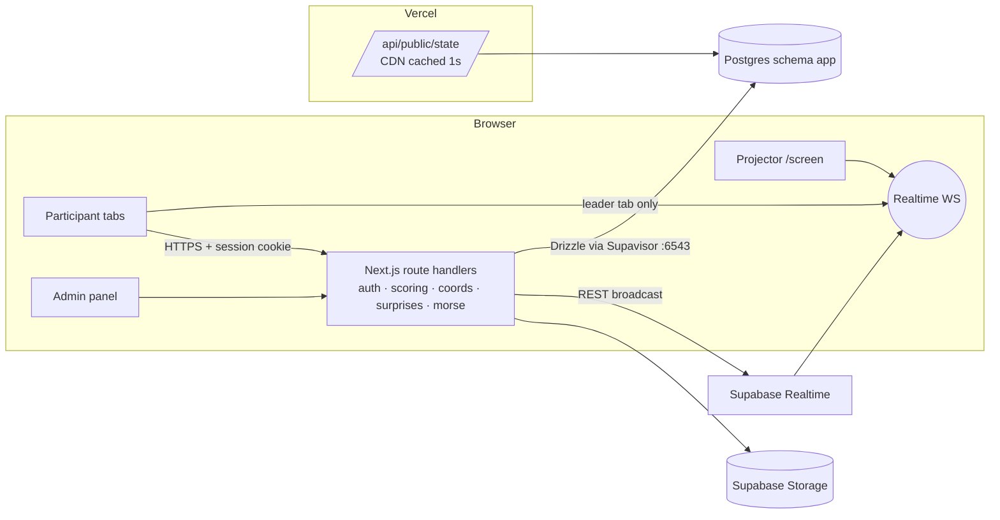

# 02 — Technical Requirements Document (TRD)

**Product:** SPIDEY tracXer — Search the SpiderXman
**Read with:** 01-PRD (the *what*), 05-Backend-Schema (the tables), 06-Implementation-Plan (the order)

This document holds every technical decision that the approved plan plus the change set fixed. When code and this document disagree, this document wins. Change it deliberately rather than drifting.

---

## 1. Stack (final)

| Layer | Choice | Notes |
|---|---|---|
| Framework | **Next.js 15 (App Router) + TypeScript (strict)** | One app holds the UI and the API. Route handlers live in `src/app/api/**/route.ts`. |
| Runtime | Node.js runtime for every route handler (`export const runtime = 'nodejs'`) | Argon2 and `node:crypto` need Node, not Edge. |
| UI | Tailwind CSS v4 + shadcn/ui (Radix) | Dark theme tokens in Design Brief §4. |
| Motion | `motion` (Framer Motion) | Respect `prefers-reduced-motion`. |
| Database | **Supabase Postgres** | All app tables live in a **private schema `app`**, which is *not* exposed through the Supabase Data API. |
| DB access | **Drizzle ORM + `postgres` (postgres-js)** | Use the Supavisor **transaction pooler** (port 6543) with `prepare: false`, and `max: 1` per serverless instance. Migrations are plain SQL in `supabase/migrations/`. |
| Realtime | **Supabase Realtime, Broadcast only**, on **public** channels | No Postgres Changes, no Presence, no private channels. See §6. |
| Server → Realtime | Supabase **REST broadcast endpoint** (`POST /realtime/v1/api/broadcast`) with the service key | No websocket is opened from serverless functions. |
| Validation | Zod | Every request body and query string. |
| Passwords | **Argon2id** via `@node-rs/argon2` | Tuned in §5. |
| Hashing secrets | HMAC-SHA256 (`node:crypto`) with keyed secrets | Flags, coordinates, codes and answers. Constant-time compare. |
| Encryption | AES-256-GCM (`node:crypto`) | For the final-trace reveal payload only. |
| Storage | Supabase Storage. Public bucket `challenge-assets` for non-secret media, private bucket `private-assets` for per-team files (served through our API). | |
| Hosting | **Vercel** (app) + **Supabase** (DB, Realtime, Storage) | Recommended spend in §11. |
| Tests | Vitest (unit and integration against a local Supabase), Playwright (E2E), k6 (load) | |
| Tooling | pnpm, ESLint, Prettier, Supabase CLI (local stack), `tsx` for scripts | |

Version pins: use the latest stable Next 15.x, React 19, drizzle-orm, postgres 3.x, @supabase/supabase-js 2.x. Before writing integration code, check current API shapes in the official docs (Context7, if available).

## 2. Architecture



Principles:
1. **The server is authoritative.** The browser never decides correctness, points, phase or time.
2. **Secrets never leave the server.** No flag, hash, HMAC key, coordinates, Morse digits, surprise answer or unrevealed signal code is ever sent in HTML, JS, an API response or a broadcast.
3. **Realtime carries only pings and public data.** Clients always re-fetch the truth over HTTP. A lost message costs a little latency, never correctness.
4. **The database enforces invariants:** unique solves, a single coordinate winner, and rate limits through counted rows inside transactions.

## 3. Environment variables (`.env.example`)

```bash
# --- Supabase ---
NEXT_PUBLIC_SUPABASE_URL=            # https://<ref>.supabase.co
NEXT_PUBLIC_SUPABASE_ANON_KEY=       # publishable key, used ONLY for Realtime subscribe
SUPABASE_SERVICE_ROLE_KEY=           # server only: REST broadcast + storage
DATABASE_URL=                        # Supavisor transaction pooler, port 6543 (runtime)
DIRECT_DATABASE_URL=                 # direct or session connection, port 5432 (migrations, seed)

# --- App secrets (each 32+ random bytes, base64) ---
SESSION_PEPPER=                      # mixed into session-token hashes
FLAG_HMAC_KEY=                       # HMAC for flags + surprise/morse/signal answers
VARIANT_HMAC_KEY=                    # derives per-team tokens and values
COORD_HMAC_KEY=                      # HMAC for normalised coordinates
REVEAL_ENC_KEY=                      # AES-256-GCM key for the final-trace payload
CSRF_SECRET=

# --- Event config ---
FLAG_PREFIX=SPIDEY
EVENT_TIMEZONE=Asia/Kolkata
MAX_SESSIONS_PER_TEAM=2
REALTIME_CHANNEL_PREFIX=spidey       # channels: spidey:public, spidey:ping

# --- Argon2id (tuned, see TRD §5) ---
ARGON2_MEMORY_KIB=19456
ARGON2_TIME_COST=2
ARGON2_PARALLELISM=1

# --- Seed and tests only (never used at runtime) ---
SEED_ADMIN_USERNAME=admin
SEED_ADMIN_PASSWORD=                 # required when running seed
WIPEABLE_DB_REF=                     # dev project ref that seed and tests may wipe. Never the event project.
```

Generate the secrets with `node -e "console.log(require('crypto').randomBytes(32).toString('base64'))"`. Real secrets never go in git. `src/lib/env.ts` validates every variable with Zod at boot and refuses to start if one is missing.

## 4. Folder structure (fixed: API under `src/app/api`)

```text
spidey-tracxer/
├── CLAUDE.md
├── README.md
├── .env.example
├── docs/                         # these 6 docs + ops runbook
├── supabase/
│   ├── config.toml               # Supabase CLI local stack
│   └── migrations/
│       ├── 0001_init.sql         # schema app, enums, tables, indexes, view, functions
│       └── 0002_security.sql     # revokes, RLS on, storage buckets
├── scripts/
│   ├── seed.ts                   # 1 admin, 10 test teams, practice + 10 challenges
│   ├── gen-secrets.ts
│   ├── bench-argon2.ts
│   └── export-results.ts
├── load/                         # k6 scripts
├── public/
│   ├── robots.txt                # contains challenge clue (intended)
│   ├── challenges/<n>/...        # static non-secret challenge assets and clue JS
│   └── fx/                       # svg spider, web textures, short sfx
├── src/
│   ├── app/
│   │   ├── (public)/login/page.tsx
│   │   ├── (team)/dashboard/page.tsx
│   │   ├── (team)/challenge/[number]/page.tsx
│   │   ├── (team)/toolkit/page.tsx
│   │   ├── (team)/manual/page.tsx
│   │   ├── (team)/coordinates/page.tsx
│   │   ├── (team)/leaderboard/page.tsx
│   │   ├── (team)/layout.tsx     # auth guard + RealtimeProvider + overlays
│   │   ├── finale/page.tsx
│   │   ├── screen/page.tsx       # projector view (admin session)
│   │   ├── admin/login/page.tsx
│   │   ├── admin/(panel)/layout.tsx
│   │   ├── admin/(panel)/{page,teams,challenges,event,monitor,surprises,morse,scores,coordinates,audit}/...
│   │   ├── vault/[slug]/route.ts # challenge-only routes (custom headers etc.)
│   │   └── api/
│   │       ├── auth/{login,logout,session,admin-login}/route.ts
│   │       ├── public/state/route.ts          # cached public snapshot
│   │       ├── public/feed/route.ts
│   │       ├── me/route.ts                    # team state: solves, score, rank
│   │       ├── me/pending/route.ts            # active surprises/signal/morse for me
│   │       ├── challenges/route.ts
│   │       ├── challenges/[number]/route.ts
│   │       ├── challenges/[number]/submit/route.ts
│   │       ├── challenges/[number]/hints/route.ts
│   │       ├── challenges/[number]/assets/[asset]/route.ts
│   │       ├── coordinates/route.ts
│   │       ├── coordinates/submit/route.ts
│   │       ├── surprises/[id]/submit/route.ts
│   │       ├── signal/[id]/reveal/route.ts
│   │       ├── signal/[id]/submit/route.ts
│   │       ├── morse/[id]/submit/route.ts
│   │       ├── time/route.ts                  # server clock for sync
│   │       └── admin/...                      # see §7.3
│   ├── components/{ui,shared,participant,challenge,leaderboard,coordinates,surprises,morse,admin,fx}/
│   ├── lib/
│   │   ├── env.ts
│   │   ├── db/{client.ts,schema.ts,queries/}
│   │   ├── auth/{password.ts,session.ts,guards.ts,csrf.ts}
│   │   ├── crypto/{hmac.ts,aead.ts,tokens.ts}
│   │   ├── flags/{normalize.ts,verify.ts}
│   │   ├── variants/{derive.ts,generators/,render.ts}
│   │   ├── scoring/{points.ts,submit.ts}
│   │   ├── coordinates/{normalize.ts,submit.ts}
│   │   ├── ratelimit.ts
│   │   ├── realtime/{broadcast.ts,client.ts,leader.ts,events.ts}
│   │   ├── morse/{encode.ts,timeline.ts}
│   │   ├── surprises/{signal.ts,flash.ts,mutation.ts}
│   │   ├── audit.ts
│   │   └── http.ts               # json(), error(), withTeam(), withAdmin()
│   ├── hooks/
│   ├── middleware.ts             # cookie presence + route-group redirects only
│   └── types/
└── tests/{unit,integration,e2e}/
```

## 5. Authentication and sessions

### 5.1 Argon2id tuning for serverless
- Library: `@node-rs/argon2` (native, prebuilt for Vercel's Linux, no node-gyp).
- Defaults: **m = 19456 KiB (19 MiB), t = 2, p = 1**, the OWASP minimum recommended profile. Each hash takes about 40–80 ms of CPU on a Vercel function.
- `scripts/bench-argon2.ts` measures one hash and then 100 concurrent hashes in-process. Run it locally and in a Vercel preview through a temporary admin-only route.
- **Acceptance:** with 100 simultaneous logins (k6, §12), p95 under 1.5 s, no 5xx and no function memory errors.
- **Fallback ladder** if p95 fails: (1) `m=12288, t=3`; (2) `m=9216, t=4`. All are still OWASP-equivalent profiles. Parameters live in the encoded hash, so old hashes keep verifying after a change.
- Team passwords are random: 4 words or 12 base32 characters, generated by the server and exported once as CSV.

### 5.2 Sessions
- Token: 32 random bytes in base64url. The cookie `st_session` is `HttpOnly; Secure; SameSite=Lax; Path=/`.
- DB stores `token_hash = SHA-256(token || SESSION_PEPPER)`.
- **Max `MAX_SESSIONS_PER_TEAM` (= 2) active sessions per team.** On login, inside one transaction:
  1. `pg_advisory_xact_lock(hashtext('login:'||team_id))`.
  2. Count active sessions (not revoked, not expired).
  3. If the count is 2 or more (the limit), revoke the oldest with `revoke_reason='evicted'`.
  4. Insert the new session.
- Every request through `withTeam()` / `withAdmin()`:
  1. Hash the cookie and look up an active session with a role match.
  2. Throttle `last_seen_at` updates to once per 60 s.
  3. A revoked session returns 401 with `{reason}`, and the client shows "Logged in on another device" or "Session ended by admin".
- Admin sessions use the same table with `team_id NULL`.
- CSRF: every mutating `POST` needs header `x-csrf-token` matching an HMAC of the session id (double-submit, derived on the server). Combined with `SameSite=Lax` and a JSON-only content-type check.
- Login rate limit: counted from `app.login_attempts` (§05) as 10 failures per username per 10 min and 30 per IP per 10 min.

### 5.3 Middleware
`middleware.ts` only checks that the cookie exists and redirects (`/dashboard` to `/login`, `/admin/*` to `/admin/login`). **Real authorization happens in every route handler and server component** through `requireTeam()` / `requireAdmin()`. Never trust middleware alone.

## 6. Realtime design (decision for change #3)

### 6.1 Decision: public broadcast + "check now" ping + authenticated fetch

**Chosen:** public Broadcast channels that carry only public data or contentless pings. Every team-specific event (Spidey Signal, Morse, targeted Mutation) is announced by a public ping. Each client then calls our authenticated API (`GET /api/me/pending`), and the server decides what that team sees.

**Rejected:** minting short-lived Supabase JWTs for private channels.

**Why:**
1. **No second auth system.** Private channels need RLS policies on `realtime.messages` that read JWT claims we would mint and sign. That means a second trust boundary, with key rotation and expiry refresh to get wrong under event pressure.
2. **Nothing private ever rides the socket.** The ping says "something changed", never "for team 7" or "the code is…", so a participant who watches the WebSocket in DevTools learns nothing.
3. **Fewer connections and joins.** One shared channel set instead of 35 team channels plus refresh churn. That matters for the concurrent-connection and joins-per-second quotas.
4. **Self-healing.** The same `/api/me/pending` call runs on a 15 s poll and on every reconnect or tab focus, so a missed ping is caught within 15 s.
5. **Cost is trivial.** Targeted events are rare (a few per event), so a burst of about 120 authenticated fetches per ping is negligible.

Optimisation, optional (M7): each session gets a random `inbox_tag` at login. A ping may carry `tags: [...]` so only targeted clients fetch. Tags are opaque and unlinkable to team names.

### 6.2 Channels and events

| Channel | Event | Payload (complete) | Client reaction |
|---|---|---|---|
| `spidey:public` | `board` | `{ v }` (scoreboard version) | Fetch `/api/public/state` now and again 1.5 s later (catches coalesced trailing updates). |
| `spidey:public` | `phase` | `{ phase, endsAt, v }` | Show banner, refetch state and `/api/me`. |
| `spidey:public` | `winner` | `{ teamName }` | Full-screen announcement, refetch. |
| `spidey:public` | `frozen` | `{ frozen }` | Refetch (gets the snapshot). |
| `spidey:public` | `finale` | `{ startedAt }` | Navigate to `/finale`. |
| `spidey:public` | `flash` | `{ id, assetUrl, showMs, startsAt }` | Play the flash at `startsAt` (server time), then fetch the question through `/api/me/pending`. |
| `spidey:ping` | `check` | `{ kind, tags? }` (`kind` ∈ `signal`, `morse`, `mutation`, `surprise`) | Call `/api/me/pending`. |

No payload ever contains answers, codes, digits or team IDs.

### 6.3 Connection budget (one socket per browser, not per tab)
- Participants open several tabs (dashboard plus challenge tabs). **Only one tab per browser holds the Realtime socket.** Leader election uses `navigator.locks.request('spidey-rt-leader')`, and the leader relays events to other tabs over `BroadcastChannel('spidey')`. Follower tabs poll every 15 s as a fallback.
- Expected sockets: about 35 teams × up to 2 devices ≈ **70** + projector + 1–3 admins ≈ **75**, with a 2× allowance for reconnect churn.

### 6.4 Message-rate budget (coalescing)
Supabase counts each delivered message. One broadcast to 75 subscribers is about 75 messages.
- **Coalescing gate:** after a solve commits, the server runs
  `UPDATE app.broadcast_gate SET last_sent_at = now() WHERE topic='board' AND last_sent_at < now() - interval '1 second' RETURNING 1`.
  It broadcasts only if a row comes back. Because clients refetch again at +1.5 s, the trailing updates inside the window are still picked up.
- Worst case is then about 1 `board` message/s × 75 subscribers ≈ **75 msgs/s**, plus rare other events.

### 6.5 Public state endpoint (CDN-absorbed)
- `GET /api/public/state` returns `{ v, phase, phaseEndsAt, frozen, leaderboard[], feed[20], winner?, serverTime }`.
- Headers: `Cache-Control: public, s-maxage=1, stale-while-revalidate=5`. Vercel's CDN serves the ~75 near-simultaneous refetches from cache, so the database sees about 1 query per second.
- When frozen it returns the stored snapshot. The admin uses `/api/admin/leaderboard` (uncached, live).
- No team-private field is ever in it.

## 7. API contract

All bodies are JSON and validated with Zod. Error shape: `{ error: { code, message, retryAfter? } }`.

### 7.1 Auth
| Method | Path | Body | Returns |
|---|---|---|---|
| POST | `/api/auth/login` | `{ username, password }` | `{ team: { name }, csrf }`, sets cookie |
| POST | `/api/auth/admin-login` | `{ username, password }` | `{ csrf }` |
| POST | `/api/auth/logout` | — | 204 |
| GET | `/api/auth/session` | — | `{ role, teamName?, csrf }` |

### 7.2 Participant (requires team session)
| Method | Path | Notes |
|---|---|---|
| GET | `/api/me` | Score, rank, solved challenge numbers, phase, current point table. |
| GET | `/api/challenges` | 10 cards + practice: number, title, difficulty, currentPoints, solved, hasFragment flag **hidden** (do not reveal which carry fragments). |
| GET | `/api/challenges/:n` | Rendered team variant (story, question, materials, hint count). Locked (423) before `main_ctf` except practice. |
| POST | `/api/challenges/:n/submit` | `{ flag }` → `{ result: 'correct'|'wrong'|'already_solved'|'rate_limited'|'closed', points?, fragment?, orderClue?, attemptsLeft?, retryAfter? }` |
| POST | `/api/challenges/:n/hints` | `{ index }` → hint text (free; logged) |
| GET | `/api/challenges/:n/assets/:asset` | Per-team generated file (log, image with EXIF), streamed, `Cache-Control: private, no-store` |
| GET | `/api/coordinates` | `{ fragments: [{ challengeNumber, value, orderClue }], locked, winnerTeamName? }` |
| POST | `/api/coordinates/submit` | `{ coordinates }` → `{ result: 'winner'|'wrong'|'locked'|'rate_limited'|'closed' }` |
| GET | `/api/me/pending` | `{ signal?: {id, expiresAt}, morse?: {id, timeline, epochMs, unitMs, expiresAt, paused}, surprises: [{id, type, title, contentHtml, expiresAt}] }` |
| POST | `/api/signal/:id/reveal` | Returns the code **only** to the targeted team, only while active. |
| POST | `/api/signal/:id/submit` | `{ code }` |
| POST | `/api/surprises/:id/submit` | `{ answer }` |
| POST | `/api/morse/:id/submit` | `{ digits }` |
| GET | `/api/time` | `{ serverTime }` (no-store) for clock offset |

### 7.3 Admin (requires admin session; every mutation writes `audit_log`)
`/api/admin/teams` (GET list, POST bulk create → CSV of credentials once), `/api/admin/teams/:id` (PATCH rename/deactivate/hide), `/api/admin/teams/:id/reset-password`, `/api/admin/teams/:id/revoke-sessions`,
`/api/admin/challenges` (GET/POST), `/api/admin/challenges/:id` (GET/PATCH/DELETE), `/api/admin/challenges/:id/flag` (POST set static flag secret or regenerate), `/api/admin/challenges/:id/regenerate-variants`, `/api/admin/challenges/:id/preview?team=`,
`/api/admin/event/phase` `{ phase, endsAt? }`, `/api/admin/event/submissions` `{ open }`, `/api/admin/event/freeze` `{ frozen }`, `/api/admin/event/coordinates` `{ answer, hemisphere, bonus, traceText }`, `/api/admin/event/finale`,
`/api/admin/leaderboard` (live), `/api/admin/monitor?type=&team=&since=`,
`/api/admin/signal/trigger` `{ points, durationSec }`, `/api/admin/surprises` (CRUD), `/api/admin/surprises/:id/{activate,close}`,
`/api/admin/morse` (POST create `{ digits, unitMs, points, expiresInSec, targets: 'all'|teamIds[] }`), `/api/admin/morse/:id/{start,pause,resume,stop}`,
`/api/admin/scores/adjust` `{ teamId, points, reason }`, `/api/admin/audit`, `/api/admin/export`.

## 8. Core algorithms

### 8.1 Flag normalisation and verification
```text
normalize(input):
  s = input.trim()
  match /^([A-Za-z0-9_]+)\{(.*)\}$/s  else → wrong (no hash computed, still logged as 'malformed')
  prefix must equal FLAG_PREFIX case-insensitively
  inner = match[2].trim().toLowerCase()
  return `${FLAG_PREFIX}{${inner}}`
verify(team, challenge, input):
  h = HMAC_SHA256(FLAG_HMAC_KEY, normalize(input))  // hex
  expected = team_challenge_variants.expected_flag_hash
  return timingSafeEqual(h, expected)
```
Only the HMAC is logged for wrong attempts (`submitted_hash`). The plaintext of wrong attempts is never stored, so a DB leak reveals nothing. Exception: `app.submissions.submitted_preview` keeps the first 12 characters of wrong attempts for the admin monitor (spotting shared wrong flags), and it is cleared after the event by `export-results.ts`.

### 8.2 Variant derivation (change #1)
The organisers write every question (see `QUESTIONS_TEMPLATE.md`). The platform makes it team-specific through placeholders.
```text
seed      = HMAC_SHA256(VARIANT_HMAC_KEY, `${team_id}:${challenge_id}`)    // 32 bytes
teamToken = base32(seed[0..5]).toLowerCase()                              // Crockford base32, 8 chars, e.g. "k3w9qz2m"
rng       = seeded PRNG (sfc32) from seed                                 // {{rand:..}}, {{rand_word}}, {{noise:N}}
fragment  = challenges.fragment_value  (IDENTICAL for every team; null if no fragment)
flag      = flag_mode == 'team'
              ? `${PREFIX}{${render(flag_template, {token, fragment}).toLowerCase()}}`
              : (organiser's static flag; only its HMAC is stored)
render(question/evidence/inspect/file templates, { flag, token, fragment, rng })
  → placeholders + chainable transforms: base64, hex, url, url2, rot13, caesar:N, reverse, sha256, binary
variant_data       = { html, evidence, surfaces, files }   // rendered values; plaintext flag only where the organiser placed {{flag}} on purpose
expected_flag_hash = flag_mode == 'team' ? HMAC_SHA256(FLAG_HMAC_KEY, normalize(flag)) : challenges.static_flag_hash
```
- `team_challenge_variants` has **no** `fragment_value`. The fragment always comes from `challenges`.
- Generators: `template` (default, text only), `exif-image` (writes a templated EXIF field into an uploaded base image, per team), `log-file` (templated lines + `{{noise:N}}` realistic random lines), `text-file`, and `placeholder` (seed only). Each lives in `src/lib/variants/generators/<key>.ts`, is a pure function of (challenge, seed), and has round-trip unit tests (the rendered clue decodes back to the exact flag).
- Static mode exists for questions that genuinely can't vary. Teams can share a static flag, so the editor and importer warn about it, and a static flag must contain its fragment (checked when entered, before hashing).
- Regenerate when: a team is created, a challenge's template, fragment or config changes, or the admin clicks "Regenerate". Regenerating never deletes solves.

### 8.3 Points (server-side, change-proof)
```text
points(difficulty, phase) = phase == 'ai_mode' ? challenge.ai_points : challenge.base_points
accept submissions iff event_state.submissions_open AND phase ∈ {main_ctf, ai_mode}
practice challenge: accepted in onboarding/main_ctf/ai_mode, always 0 points
```

### 8.4 Flag submit (transactional)
```text
BEGIN
  SELECT phase, submissions_open FROM app.event_state WHERE id=1 FOR SHARE   -- phase cannot change mid-txn
  if closed → ROLLBACK 'closed'
  if exists solve(team,challenge) → ROLLBACK 'already_solved'
  wrong = count(submissions where team,challenge, is_correct=false, submitted_at > now()-60s)
  if wrong >= 5 → ROLLBACK 'rate_limited' (retryAfter = oldest+60s-now)
  correct = verify(...)
  INSERT submissions(team, challenge, submitted_hash, is_correct, preview?)
  if !correct → COMMIT 'wrong' (attemptsLeft = 4 - wrong)
  INSERT solves(team, challenge, points, phase) ON CONFLICT (team_id, challenge_id) DO NOTHING RETURNING id
  if no row → COMMIT 'already_solved'
  COMMIT 'correct' { points, fragment?, orderClue? }
after commit: gate-and-broadcast 'board'
```
The phase change by the admin takes `FOR UPDATE` on `event_state`, so it waits for in-flight submits and the other way round. A solve is therefore scored by the phase that was true when it committed.

Concurrent duplicate solves are settled by the unique index plus `ON CONFLICT DO NOTHING`. Rate-limit counting is per team and challenge, protected by `pg_advisory_xact_lock(hashtext(team_id||challenge_id))` taken first, so parallel tabs cannot both slip in a 6th wrong attempt.

### 8.5 Coordinates
```text
normalizeCoords(text, hemisphere = {lat:'N', lon:'E'}):
  strip spaces, degree signs, and N/S/E/W letters (letters apply sign: S/W → negative)
  extract exactly two decimal numbers via /-?\d{1,3}\.\d{1,6}/g
  lat ∈ [-90,90], lon ∈ [-180,180] else → wrong
  if no letter given, apply configured hemisphere sign
  return `${lat.toFixed(4)},${lon.toFixed(4)}`          // canonical
answer_hash = HMAC_SHA256(COORD_HMAC_KEY, canonical)
```
Submit (atomic first winner):
```text
BEGIN
  SELECT * FROM app.event_state WHERE id=1 FOR UPDATE      -- serializes all coordinate submits
  if not open phase → 'closed'; if coordinates_locked → 'locked'
  rate limit: wrong coordinate attempts by team in last 60s >= 5 → 'rate_limited'
  correct = timingSafeEqual(HMAC(normalize(input)), coordinate_answer_hash)
  INSERT coordinate_submissions(team, submitted_hash, is_correct)
  if correct:
     UPDATE event_state SET coordinates_locked=true, coordinate_winner_id=team, coordinate_won_at=now()
     INSERT winners(team, 'coordinates', bonus_points = event_state.winner_bonus_points)
     audit
COMMIT → broadcast 'winner' {teamName} and 'board'
```
Plus a DB guarantee: `UNIQUE (winner_type)` on `winners` (only one coordinates winner can ever exist).

### 8.6 Spidey Signal
- Trigger (admin): pick a random **active, non-hidden** team that has at least 1 live session (`last_seen_at` within 2 min), excluding the previous signal's team. Insert `spider_signal_codes(team, expires_at = now()+60s, points)`. Broadcast `check {kind:'signal'}`.
- Code: `code = base32(HMAC(FLAG_HMAC_KEY, 'signal:'||id))[0..8]` in uppercase. It is derived, never stored in plaintext. `code_hash` = HMAC of the code.
- `/api/signal/:id/reveal` returns the code only to the target team, only before `expires_at`, and sets `revealed_at`.
- Submit: the target team only, within `expires_at + 60s` grace, 5 wrong per minute, once. It sets `redeemed_at` and `points_awarded`.

### 8.7 Morse
- Encoding: digits 0–9 in standard Morse (`1 = .----`, …, `0 = -----`). Timing: dot = 1 unit, dash = 3, gap inside a symbol = 1, between digits = 3, between repeats = 7 units, then repeat. Default `unit_ms = 300` (≈ 1.7 blinks/s, under the 3 Hz photosensitivity limit). Minimum allowed `unit_ms = 200`.
- Stored: `digits_hash` (HMAC) and `digits_ciphertext` (AES-GCM, so the admin can view it). The **timeline** array (on/off durations) is computed when the transmission starts and stored.
- Clock sync: a client calls `/api/time` 3 times and takes `offset = serverTime - (t0+t1)/2` from the call with the lowest RTT.
- Playback: `position = (serverNow - started_at - paused_total_ms) mod cycle_ms`, so every screen blinks in sync. Pause sets `paused_at`. Resume adds `now - paused_at` to `paused_total_ms`.
- The timeline is delivered by an authenticated endpoint to target teams only. A team that reads it in DevTools still has to decode Morse, which is the challenge, so this is acceptable and documented to admins.
- `expires_at` defaults to start + 5 min and is extended by any pause duration.

### 8.8 Flash Spidey and Mutation
- Flash: the asset is public (non-secret). The question `contentHtml` is returned only by `/api/me/pending` after `starts_at + show_ms`. `answer_hash` is an HMAC of the normalized answer (trim, lowercase, collapse whitespace). `max_winners`, if set, is enforced in a transaction with `FOR UPDATE` on the surprise row.
- Mutation: the same model with `targets` (all or chosen teams) and a puzzle `content`.

### 8.9 Rate limits (change #7) — all counted from attempt tables inside the submit transaction

| Action | Limit | Key |
|---|---|---|
| Flag submit | 5 wrong / 60 s | team + challenge |
| Coordinates | 5 wrong / 60 s | team |
| Surprise answer | 5 wrong / 60 s | team + surprise |
| Morse answer | 5 wrong / 60 s | team + transmission |
| Signal code | 5 wrong / 60 s | team + signal |
| Login | 10 fail / 10 min per username; 30 per IP | `login_attempts` |
| Hints | 30 / 60 s | team (sanity only) |

## 9. Challenge rendering and inspect surfaces
- Challenge content is authored by the admin (trusted) and stored as a template with `{{var}}` placeholders. It is rendered **on the server** into the actual page HTML, so that **View Source and Elements show the clues**. That is intended.
- Sanitisation: allow-list HTML (including comments, `<meta>`, `hidden`, `data-*` and `<template>`). Scripts are not allowed inline; clue JS is a static file under `/public/challenges/<n>/` reading values from a `<script type="application/json" id="clue">` block.
- Inspect surfaces supported per challenge through `variant_data.surfaces`: `htmlComment`, `metaTags[]`, `hiddenElements[]`, `jsonClue`, `cookies[]` (set by the challenge page response, `Path=/challenge/<n>`, **never** HttpOnly, named `clue_*`), `localStorage[]` (written by the static clue JS), `headers[]` (set on `/vault/[slug]` responses, named `x-spidey-*`), and `robots.txt` (static, global).
- **Isolation rule:** clue cookies and values are dummies. Never place a session token or real secret on these surfaces, and never name a clue cookie like `st_session`.
- CSP: `default-src 'self'; script-src 'self' 'nonce-…'; img-src 'self' data: https://<supabase>; media-src 'self' https://<supabase>; connect-src 'self' https://<supabase> wss://<supabase>; frame-ancestors 'none'`.

## 10. Scoreboard (change #6)
One SQL view, `app.v_scoreboard` (full SQL in 05-Backend-Schema §6), summing:
`solves.points_awarded + surprise_submissions.points_awarded + spider_signal_codes.points_awarded + morse_submissions.points_awarded + score_adjustments.points + winners.bonus_points`.
Ranking: `ORDER BY total DESC, last_score_at ASC, team_name ASC`. Hidden teams are excluded from the public board but shown to the admin.

Freeze: `POST /api/admin/event/freeze` writes `scoreboard_snapshots(snapshot jsonb)` and sets `leaderboard_frozen=true`. The public state then serves the latest snapshot. Unfreezing serves live data again.

## 11. Hosting recommendation (decision 7: reliability over zero cost)

| Item | Recommendation | Why |
|---|---|---|
| **Supabase** | **Pro plan for the event month (~US$25)**. Downgrade afterwards. | Free Realtime allows 200 concurrent connections and 100 messages/s. Pro allows 500 and 500/s. Our budget (§6.3–6.4) is about 75 sockets and about 75 msgs/s at peak. That fits Free on paper, but 75 of 100 msgs/s leaves little headroom for reconnect storms, phase and winner bursts on top of board pings, or a larger turnout than expected. Free projects also pause after 7 days of inactivity. Pro adds daily backups. |
| **Vercel** | **Hobby is acceptable** (non-commercial college event). Optionally start the Pro trial in event week for better limits and support. | Hobby is restricted to non-commercial, personal use, which fits a free student event. Keep the app on Node functions with Fluid compute (default). |
| Domain | Optional (~₹800/yr). | A short URL helps onboarding. The Vercel subdomain works too. |
| Fallback | Run a full rehearsal on the same plan 3+ days before. Export DB the night before and at 4:30 PM. | |

Total recommended spend: **about $25**. If the budget is truly zero, stay on Free for both, and enforce the one-socket-per-browser rule (§6.3), coalescing (§6.4) and 15 s polling fallback. The app still works if Realtime is throttled, just with up to 15 s lag.

## 12. Testing and performance requirements
- **Unit:** flag normalise and verify, coordinate normalisation (20+ formats), Morse encode and timeline, every generator (planted value decodes back to the flag), points table, variant determinism.
- **Integration (local Supabase):** concurrent double-submit gives 1 solve; 50 concurrent correct coordinate submits give exactly 1 winner; a phase switch during a burst scores each solve by its commit-time phase; rate limits; the 3-session cap evicts the oldest; frozen board.
- **E2E (Playwright):** login → dashboard → open challenge in new tab → solve → board updates in a second browser context; admin phase change → banner; signal for one team only; finale.
- **Load (k6):** 100 VUs logging in within 60 s; 80 Realtime subscribers (2 per team + screen + admin); 1 solve/s sustained plus bursts of 10/s for 30 s; 20 simultaneous correct coordinate submits; 1 signal; 1 Morse. Targets: PRD NFR-2, no 5xx, no duplicate awards.
- **Secret-leak test:** run a script that crawls every participant page and API response for one team and greps for each plaintext flag, each other team's token, the coordinates, the Morse digits and the env secret values. It must find zero matches.

## 13. Observability and operations
- Structured JSON logs (`event`, `teamId`, `challenge`, `result`, `ms`) without secrets.
- Admin monitor shows the attempt stream, sessions per team, Realtime health (last broadcast time, connected-client estimate from leader heartbeats) and DB latency.
- `scripts/export-results.ts` writes CSV/JSON of teams, solves, attempts (no plaintext) and the final board.
- Event-day runbook: 06-Implementation-Plan, Appendix B.
