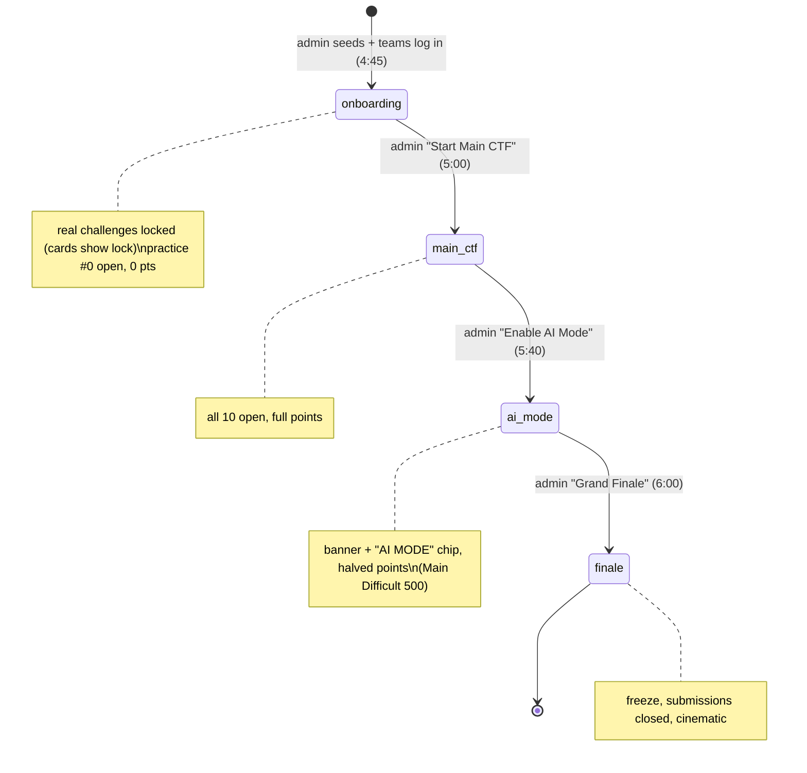
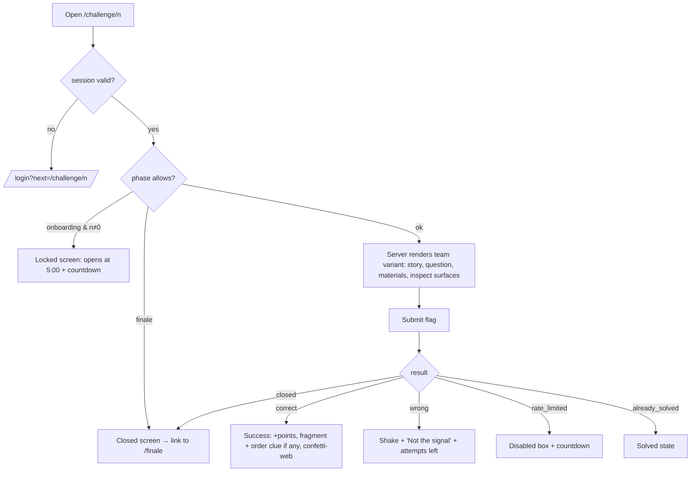
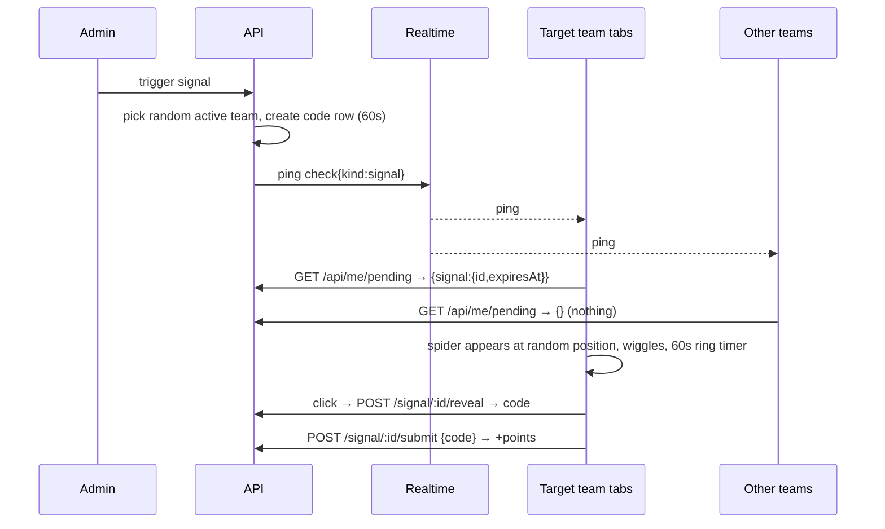
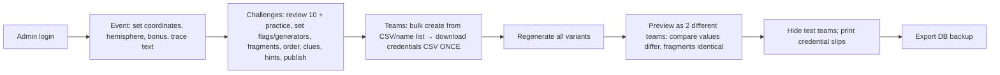

# 03 — App Flow Document

> **Rules v2:** parts of this document are superseded by [07-Rules-v2.md](07-Rules-v2.md) (scoring, login, locations, surprises, no AI Mode). Where they disagree, 07 wins.

**Product:** SPIDEY tracXer — Search the SpiderXman
**Purpose:** every screen, every route, every state, and what happens on each user action. Use it as the checklist for the UI and the E2E tests.

---

## 1. Route map

| Route | Who | Purpose |
|---|---|---|
| `/` | anyone | Landing. "Signal lost" intro, **Team Login** button, small admin link in the footer. Redirects to `/dashboard` if a team is logged in. |
| `/login` | public | Team login. |
| `/dashboard` | team | Challenge grid, score, rank, phase banner, feed. |
| `/challenge/[number]` | team | One challenge (opens in a **new tab**). `0` = practice. |
| `/toolkit` | team | Built-in tools (client-side only). |
| `/manual` | team | Beginner manual. |
| `/coordinates` | team | Coordinate Board + final submission. |
| `/leaderboard` | team | Full live (or frozen) board + feed. |
| `/finale` | team, screen | Cinematic ending. |
| `/vault/[slug]` | team | Challenge-only routes (custom headers, robots.txt target). |
| `/admin/login` | public | Admin login. |
| `/admin` | admin | Overview: phase, clock, live board, health. |
| `/admin/teams` | admin | Teams, credentials, sessions. |
| `/admin/challenges` (+ `/[id]`) | admin | Challenge editor, preview as team, regenerate. |
| `/admin/event` | admin | Phases, submissions open/close, freeze, coordinate config, **Grand Finale**. |
| `/admin/monitor` | admin | Live attempt stream. |
| `/admin/surprises` | admin | Spidey Signal, Flash Spidey, Spidey Mutation. |
| `/admin/morse` | admin | Morse transmissions. |
| `/admin/scores` | admin | Manual adjustments. |
| `/admin/audit` | admin | Audit log. |
| `/screen` | admin session | Projector view: big board, feed, banners, finale. |

Global overlays live in the team layout (`(team)/layout.tsx`) and appear on every team page, including challenge tabs: phase banner, winner announcement, Spidey Signal, Flash Spidey, Mutation drawer, Morse spider, connection indicator, session-ended modal.

## 2. Event timeline vs. what the UI shows



The admin may also go back a phase (for example, after an accidental click). Solves are never re-scored: each keeps the phase it was committed in.

## 3. Participant flows

### 3.1 Login
```mermaid
sequenceDiagram
  participant U as Team member
  participant W as /login
  participant API as /api/auth/login
  participant DB
  U->>W: username + password
  W->>API: POST
  API->>DB: rate-limit check, find user (role=team, active)
  API->>API: argon2 verify
  API->>DB: lock team, count sessions; if ≥MAX (2) revoke oldest; insert session
  API-->>W: 200 {team, csrf} + Set-Cookie st_session
  W-->>U: redirect /dashboard
```
States and messages:
- Wrong credentials: "Those credentials don't match. Check the slip your organiser gave you." Attempts are counted.
- Rate limited: "Too many attempts. Try again in N min."
- Team deactivated: "This team is disabled. Ask an organiser."
- Evicted later: the old device's next request gets 401 `{reason:'evicted'}`, and a modal reads "Your team logged in on another device. This session ended." with a **Log in again** button.

### 3.2 Dashboard
Layout, top to bottom:
1. Header: logo, team name, **score**, **rank #**, connection dot (green live, amber polling, red offline), nav (Toolkit, Manual, Coordinates, Leaderboard, Logout).
2. Phase banner: phase name + countdown to `phaseEndsAt` (if set) + rule line ("AI tools now allowed. Points halved except Main Difficult").
3. Challenge grid: **practice card** first (onboarding only, then collapses to a small link), then 10 cards grouped by difficulty: Easy ×4, Medium ×3, Difficult ×2, Main Difficult ×1.
   - Card: `#n`, title, difficulty chip, **current points** (strikes through 100 and shows 50 in AI Mode), state (Locked / Open / Solved ✓ with points earned).
   - Which challenges carry fragments is **not** shown.
   - Click → `window.open('/challenge/n', '_blank', 'noopener')`.
4. Right rail (stacks below on mobile): mini leaderboard (top 10 + own row) and live solve feed.

Live behaviour: a `board` ping refreshes score, rank, board and feed. A `phase` ping refreshes card points and lock states and shows the banner animation.

### 3.3 Challenge (new tab)

Page sections:
1. Header: `#n • Title • Difficulty • Points now`, a back link to the dashboard (same tab), and solved state.
2. **Story** (narrative, 2–4 lines).
3. **Mission** (the question).
4. **Evidence** (materials: code blocks, images, downloadable files `/api/challenges/n/assets/...`, log viewer embed).
5. **Hints** (accordion: "Reveal hint 1", free).
6. **Submit**: input placeholder `SPIDEY{...}` and a Submit button. The Enter key submits. The button is disabled while the request is in flight (prevents double submits).
7. Footer tip: "Stuck? The Manual covers this. Your Toolkit can decode it."

Inspect surfaces render invisibly (comments, meta, hidden elements, cookies, localStorage writes, headers on `/vault/...`), as designed per challenge.

Once solved, the input is replaced by: **"Signal fragment recovered"**, with the fragment value and its order clue (fragment challenges), or "Flag accepted (+N)".

### 3.4 Toolkit
Tabs: Base64 · Hex · URL · ROT/Caesar · Substitution · Hash · EXIF · Logs · Diff · Notes.
- Each transform tool has an input box, mode toggle (encode/decode), live output, a **Copy** button, and a "Send to…" action that pipes output into another tool.
- EXIF: drag-drop or file picker, parsed fully client-side (`exifr`), shown as a table.
- Logs: paste or open a file, then filter by text, level, IP or time range, with matches highlighted.
- Notes: per-team notes saved in localStorage (key `spidey_notes`), with a warning that they live on this device only.
- The banner reads "Runs only in your browser. Nothing is sent to the server."

### 3.5 Manual
A single long page with a sticky table of contents: How a CTF works → Flag format → DevTools basics (Elements, Console, Network, Application) → Base64 → Hex → URL encoding → Hashing → Metadata/EXIF → Reading logs → Headers & robots.txt → Classical ciphers → Morse code chart (digits) → Coordinates (lat/long basics) → Rules & AI Mode → FAQ. Each concept gets one worked mini-example with a "Try it in the Toolkit" link.

### 3.6 Coordinate Board
1. Title "Trace Spider-Man" with a short story line.
2. **Fragments recovered: k/6**. One card per recovered fragment: `#challenge`, fragment value (2 digits) and order clue text. Unrecovered slots show `??` with "Unknown source" (the card does not say which challenge).
3. **Assembler:** 6 slots shaped like the coordinate format `[__].[__][__] , [__].[__][__]`. Drag fragment cards into slots (keyboard: select then press 1–6). A live preview shows the string. This is purely client-side.
4. **Submit Final Coordinates:** a free-text input (prefilled from the assembler, editable) and Submit.
   - wrong → "No signal at those coordinates." + attempts left
   - rate_limited → countdown
   - winner → full-screen "SIGNAL LOCKED — YOU FOUND HIM" for this team; everyone else gets the winner banner
   - locked → "Spider-Man has been traced by **Team X**. Keep scoring. Points decide the rest."
5. After the lock, the assembler stays visible but submission is disabled. The coordinates themselves are **not** shown until the finale.

### 3.7 Leaderboard
A table with Rank, Team, Score, Solves, Last solve (relative time). Your team is highlighted. The top 3 have a spider-gold, silver or bronze accent. A feed column sits beside it. When frozen, a banner reads "Leaderboard frozen at 6:00 PM. Final results at the finale."

### 3.8 Surprise overlays (all team pages)

**Spidey Signal (one team only)**

- The spider appears in **every open tab** of the targeted team. The leader tab relays to the others.
- The code reveal shows a "Copy" button and a small submit box inline in the overlay. The team can also submit later from the dashboard widget until expiry + 60 s grace.

**Flash Spidey (all teams):** the screen dims, then a 2–8 s visual plays, synced to the server `startsAt`. Then the question card slides up with an answer box and timer (default 90 s). The result shows inline. With `max_winners`, the message says "First N teams only", and late teams see "Bonus already claimed".

**Spidey Mutation (all or targeted):** a glitch transition, then a drawer with the puzzle (may include an image or file), answer box and expiry timer. It can be minimised to a corner chip.

**Morse Transmission (targets):** a spider icon pinned bottom-right with a pulsing ring. Its body lights up for "on" and dims for "off", following the server-synced timeline. Controls: expand to large view, mute or unmute an optional beep, and "Decode" opens a digits input. When the admin pauses, the spider freezes with a "Transmission paused" label. On expiry it fades out.

**Winner announcement (all):** a 4 s full-screen takeover, "SPIDER-MAN TRACED BY **TEAM X**", then it shrinks to a persistent top chip "Trace claimed by Team X".

**Phase change (all):** a banner sweeps in. AI Mode adds a recurring "AI MODE" chip and changes accent colours (Design Brief §6).

### 3.9 Finale
`finale` broadcast → every team tab and the screen navigate to `/finale`. Submissions are closed on the server.

Sequence (about 60–75 s, skippable for admins, reduced-motion falls back to static cards):
1. Black screen, web lines draw in. "SIGNAL LOCKED…" (3 s)
2. "FINAL RANKINGS". Positions 10 to 4 roll up, then #3, #2, #1 with spotlight beats.
3. "THE TRACE": coordinate winner team name + time.
4. Map-style reveal: the coordinates type out, and the final trace text and image (admin-configured) fade in.
5. Hold, then: **"SPIDER-MAN WILL RETURN…"** (pause) **"IN SECRET WARS."** 🕷️
6. End card: thank-you + EYE club credit + team's own final rank and score.

Late joiners who open `/finale` after it started jump to the end card with a Replay button.

## 4. Admin flows

### 4.1 Pre-event setup (day before)
Questions arrive from the organisers as `QUESTIONS.md` and are loaded with `pnpm import-questions QUESTIONS.md` (or typed into the editor).



### 4.2 Teams page
- The table shows name, username, active toggle, hidden toggle, **active sessions (n/2)**, last seen, score.
- Row actions: **Reset password** (shows the new password once), **Revoke sessions**, **View sessions** (device user-agent, IP, created, last seen), Rename, Deactivate.
- Bulk: "Create teams" (paste names, one per line, or upload CSV `team_name[,username]`) → generates usernames and passwords → modal with **Download CSV** (shown once; passwords are not retrievable later, only resettable).

### 4.3 Challenge editor
Fields (same as a `QUESTIONS_TEMPLATE.md` block, which the organisers write): number, title, difficulty (auto-fills points 100/50, 200/100, 300/150, 500/500, editable), category, story, question template with placeholders (live preview as any team), evidence blocks, inspect surfaces, per-team files (base image + EXIF field, log template, text template), assets (upload), flag mode (**team**: flag template that must contain `{{token}}` / **static**: one flag for all teams, with a sharing warning), **has fragment** toggle → fragment value (2 digits) + `coordinate_order` (1–6) + order clue text, hints (ordered), published toggle.
Actions: **Preview as team…**, **Test a flag** (enter a flag and team; returns true/false without logging a submission), **Regenerate variants**.
Validation shown inline: exactly 6 fragment challenges, distribution 2E/2M/1D/1MD, orders 1–6 unique, fragments 2 digits, and the fragments in order reproduce the configured coordinates (checked on the server without showing the answer: ✓/✗).

### 4.4 Event control (during the event)
- Big phase stepper: `Onboarding → Main CTF → AI Mode → Finale`, each with a confirm dialog that states the effect ("Points for Easy/Medium/Difficult halve for solves from now on").
- Optional "Phase ends at" time (drives participant countdowns only).
- Switches: Submissions open, Leaderboard frozen, Coordinate submissions open.
- Coordinate status: locked or not, winner, time, attempts count.
- **Grand Finale** button: a two-step confirm ("type FINALE"). It runs freeze (snapshot), closes submissions, sets the phase to finale and broadcasts `finale`. It is idempotent.
- Clock: IST now, plus next scheduled action reminders (5:00, 5:40, 6:00).

### 4.5 Monitor
A live table (polling every 3 s) of attempts across all types: time, team, type, challenge or event, result, preview (first 12 chars for wrong flags). Filters by team, type and result. Highlights: the same wrong preview from 3+ teams within 5 min ("possible leak"), a team with more than 20 wrong attempts per minute, and a correct flag submitted within 10 s of another team's correct one on the same challenge.

### 4.6 Surprises and Morse
- **Spidey Signal:** points (default 50), duration (60 s), **Trigger** → shows which team was picked, a countdown, and revealed / redeemed status. **Trigger again** is allowed any time.
- **Flash Spidey:** pick asset, show ms, question HTML, answer, points, max winners, answer window → **Launch**.
- **Mutation:** puzzle HTML, optional asset, answer, points, targets (all / pick teams), expiry → **Launch** / **Close now**.
- **Morse:** digits (shown masked, eye toggle), unit ms (default 300), points (default 100), expiry (default 5 min), targets → **Create** → **Start / Pause / Resume / Stop**, with a live preview spider that blinks the same timeline and a "who solved" list.

### 4.7 Scores and audit
- Adjust: team, ± points, **reason (required)** → confirm → appears in the board and the audit log.
- Audit: filter by actor, action and time. Export CSV.

### 4.8 Projector `/screen`
Full-screen board with the top 15, feed ticker, phase banner and countdown, and winner and surprise announcements (it shows that a Spidey Signal happened, never the code). The finale plays here at full size with sound.

## 5. Cross-cutting states

| Situation | Behaviour |
|---|---|
| Realtime disconnected | The dot turns amber, the client polls `/api/public/state` and `/api/me/pending` every 15 s, and reconnects with backoff. On reconnect it does a full refetch. |
| Offline | The dot turns red. Submit buttons are disabled with "Offline, reconnecting…". Nothing is queued: retype and submit when back. |
| Session expired or revoked | The modal appears and links to `/login?next=<current>`. |
| Tab hidden → visible | Immediate refetch of state and pending, and Morse resyncs its clock. |
| Server error | Toast "Signal interference, try again", logged with a request id. |
| Phase changes while a challenge tab is open | The banner appears, points shown update, and submit uses the server phase anyway. |
| Submission while finale | `closed` → link to `/finale`. |
| Multiple devices of the same team | A solve on device A updates device B via the `board` ping + `/api/me`. Duplicate solves are rejected as `already_solved`. |
| Clock skew on client | Every timer uses `serverTime` offset from `/api/time`. |
