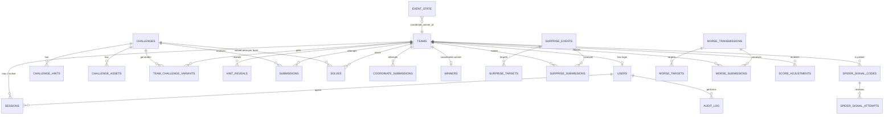

# 05 — Backend Schema Document

**Product:** SPIDEY tracXer — Search the SpiderXman
**Database:** Supabase Postgres 15+, private schema `app`
**Source of truth:** `supabase/migrations/0001_init.sql` and `0002_security.sql` (reproduced in full in §8). The migrations were run on a clean Postgres 16 and tested (§7).

---

## 1. Design rules
1. **Private schema.** Every table lives in `app`, which is not in the Supabase Data API's exposed schemas. Client roles (`anon`, `authenticated`) have no grants, and RLS is enabled with no policies (deny-all) as defence in depth. Only the Next.js server, connecting as the database owner through `DATABASE_URL`, reads or writes.
2. **No plaintext secrets.** Flags, coordinates, surprise answers, Morse digits and signal codes are stored as **HMAC-SHA256** (keys in env). Where an admin must see the value later (Morse digits, surprise answers, final trace), it is also stored **AES-256-GCM encrypted** (`*_enc` columns) with `REVEAL_ENC_KEY`.
3. **Fragments are global.** `fragment_value`, `coordinate_order` and `order_clue` live only on `app.challenges` (change #1). `team_challenge_variants` has no fragment column.
4. **Invariants live in the DB:** unique solve per team and challenge; one correct coordinate submission ever; one coordinates winner; one correct answer per team per surprise or Morse; fragment shape (2 digits, order 1–6 unique); practice challenge shape; singleton `event_state`; winner consistency.
5. **Every attempt is a row.** Rate limits are computed by counting recent wrong rows inside the submit transaction (partial indexes make it cheap).
6. **The score is derived, never stored.** `app.v_scoreboard` is the single source (change #6).

## 2. Entity relationships



## 3. Table dictionary

| Table | Purpose | Key constraints and notes |
|---|---|---|
| `teams` | Team identity. | Case-insensitive unique name. `is_hidden` hides test teams from the public board. `is_active=false` blocks login and hides from the board. |
| `users` | Login accounts (1 admin row per organiser, exactly 1 per team). | Case-insensitive unique username. Role check: admin has no team, team user has exactly one. `password_changed_at` lets a reset invalidate sessions. |
| `sessions` | Admin and team sessions. | `token_hash` unique. Team cap of `MAX_SESSIONS_PER_TEAM` (2) enforced in the login transaction (advisory lock + count + evict oldest). Stores `ip`, `user_agent`, `last_seen_at` for the admin's "View sessions". `inbox_tag` is the optional ping routing tag. |
| `login_attempts` | Brute-force limiting and audit. | Indexed by username and by IP, newest first. |
| `challenges` | 1 practice (`number=0`) + 10 real. | `number` 0–10 unique. `ai_points ≤ base_points`. Fragment shape check, 2-digit check, order 1–6 unique (partial index). The practice row must be 0 points with no fragment, and is stored as `difficulty='easy', is_practice=true` because the enum has no `practice` value (the importer maps it, and the 4/3/2/1 checks exclude it). Questions are written by the organisers: `question_template`/`evidence` hold placeholders, `generator_key` (`template`, `exif-image`, `log-file`, `text-file`, `placeholder`) + `generator_config` drive variants. `flag_mode` **team** needs a `flag_template` containing `{{token}}`; **static** needs `static_flag_hash` (same flag for all teams). Bumping `generator_version` marks variants stale. |
| `challenge_hints` | Free hints, ordered. | Unique `(challenge_id, hint_order)`. |
| `challenge_assets` | Media files. | Bucket is `challenge-assets` (public, non-secret) or `private-assets` (served by our API). `is_per_team` assets are generated at request time from the variant. |
| `team_challenge_variants` | Per-team values + expected flag hash. | Unique `(team_id, challenge_id)`. **No fragment column.** `variant_data` holds only encoded or obfuscated forms of the flag, never the plaintext. |
| `hint_reveals` | Which hints a team opened (analytics only, free). | PK `(team, challenge, hint_order)`. |
| `event_state` | Singleton (id=1): phase, switches, coordinate config and lock, finale, board version. | `CHECK id=1`. Winner consistency check. `coordinate_answer_hash` is an HMAC. `final_trace_enc` is AES-GCM. `winner_bonus_points` defaults to 300. |
| `broadcast_gate` | Coalesces `board` broadcasts to at most 1/s. | `app.try_open_gate(topic, window)` returns true for the first caller per window. |
| `submissions` | Every flag attempt. | `result` ∈ correct/wrong/malformed. `submitted_preview` (first 12 chars) only for wrong attempts and purged after the event. Partial index for rate-limit counting. |
| `solves` | Successful solves. | **`UNIQUE(team_id, challenge_id)`**. `phase` cannot be `finale`. `points_awarded` set by the server from the committed phase. |
| `coordinate_submissions` | Every coordinate attempt. | **Unique partial index on `is_correct`**: only one correct row can ever exist. Partial index for rate limits. |
| `winners` | Coordinate winner + bonus. | **`UNIQUE(winner_type)`**. Bonus copied from `event_state.winner_bonus_points` at win time. |
| `surprise_events` | Flash Spidey and Mutation. | Answer is an HMAC (+ encrypted copy). Optional `max_winners`. `target_all` or rows in `surprise_targets`. `show_ms` 1–8 s. |
| `surprise_targets` | Targeted teams. | PK `(event_id, team_id)`. |
| `surprise_submissions` | Every surprise attempt. | One correct per team per event (partial unique). Points only on correct rows (check). |
| `spider_signal_codes` | One row per Spidey Signal activation, for exactly one team. | The code is derived (`HMAC(FLAG_HMAC_KEY,'signal:'||id)`), so plaintext is never stored. `revealed_at`, `redeemed_at`, `points_awarded` (0 until redeemed, enforced). |
| `spider_signal_attempts` | Every code attempt. | Rate-limit index. |
| `morse_transmissions` | Morse broadcasts. | Digits as HMAC + encrypted copy. `unit_ms` 200–1000. `timeline` + `cycle_ms` required once started. `paused_at` set iff status is paused. `expires_at` extended by pauses. |
| `morse_targets` | Targeted teams. | PK. |
| `morse_submissions` | Every Morse attempt. | The plan's `UNIQUE(transmission, team)` is **replaced** by a partial unique on correct rows, so wrong attempts are still logged. Points only on correct rows. |
| `score_adjustments` | Manual ± points. | `points ≠ 0`. Reason of at least 3 non-blank characters is required. `admin_id` required. |
| `audit_log` | Every admin action and security event. | `details` jsonb must never contain secrets. |
| `scoreboard_snapshots` | Frozen boards. | The latest row is served while `leaderboard_frozen`. |

## 4. Views
- **`app.v_scoreboard`** (change #6, the single source of scores): a ledger `UNION ALL` of `solves.points_awarded`, `surprise_submissions.points_awarded`, `spider_signal_codes.points_awarded`, `morse_submissions.points_awarded`, `score_adjustments.points` and `winners.bonus_points`, joined to every team. Columns: `team_id, team_name, is_hidden, is_active, total, challenge_points, bonus_points, adjustment_points, winner_points, last_score_at, solves (excludes practice), rank_all`. Ranking: total desc, earliest `last_score_at`, then name. The admin uses this.
- **`app.v_public_scoreboard`**: visible, active teams only, re-ranked among themselves. Columns: `rank, team_id, team_name, total, solves, last_score_at`. `/api/public/state` returns it **without `team_id`**.
- **`app.v_public_feed`**: solves of visible teams, practice excluded: `solved_at, team_name, challenge_number, challenge_title, points_awarded`.

## 5. Transaction recipes (the server must use exactly these)

| Operation | Locking | Steps |
|---|---|---|
| Login | `pg_advisory_xact_lock(hashtext('login:'||team_id))` | Count active sessions; if ≥ `MAX_SESSIONS_PER_TEAM` revoke the oldest (`'evicted'`); insert the new one. |
| Flag submit | `pg_advisory_xact_lock(hashtext(team_id||':'||challenge_id))`, then `SELECT … FROM event_state FOR SHARE` | Closed check, solved check, count wrong in 60 s, verify, insert attempt, `INSERT solves … ON CONFLICT DO NOTHING RETURNING`. After commit: `try_open_gate('board')` → broadcast. |
| Phase change / freeze / finale | `SELECT … FROM event_state FOR UPDATE` | Update, snapshot if freezing, audit. After commit: broadcast `phase` / `frozen` / `finale`. |
| Coordinate submit | `SELECT … FROM event_state FOR UPDATE` | Closed/locked check, rate limit, verify, insert attempt; if correct: lock + winner row (bonus) + audit. After commit: broadcast `winner` + `board`. |
| Surprise / Morse / Signal submit | Advisory lock on `(team, item)`, and `FOR UPDATE` on the surprise row when `max_winners` is set | Active and target check, rate limit, verify, insert attempt with points if correct (the partial unique index blocks a second correct). |
| Variant (re)generation | none (idempotent upsert) | `INSERT … ON CONFLICT (team_id, challenge_id) DO UPDATE`. Solves are never touched. |

## 6. Indexes worth knowing
- Rate limits: `submissions_ratelimit_idx`, `coord_sub_ratelimit_idx`, `surprise_sub_ratelimit_idx`, `morse_sub_ratelimit_idx`, `signal_attempt_ratelimit_idx` (all partial on `NOT is_correct`, newest first).
- Sessions: `sessions_active_team_idx` (partial on not revoked).
- Feeds: `solves_time_idx`, `submissions_time_idx`, `audit_time_idx`.
- Invariants: `coord_sub_single_winner_uq`, `surprise_sub_one_correct_uq`, `morse_sub_one_correct_uq`, `challenges_coordinate_order_uq`.

## 7. Verification already done
Both migrations were applied to a clean Postgres 16 with `anon`/`authenticated` roles created, then tested:

| Test | Result |
|---|---|
| Migrations apply cleanly | ✅ 26 tables, 3 views |
| Scoreboard math (solve + practice + AI-mode solve + hidden team + −20 adjustment + 300 winner bonus) | ✅ totals, solve counts (practice excluded), ranks and hidden-team exclusion all correct |
| Flag mode rules (team without template, template without `{{token}}`, static without hash, both set) | ✅ all rejected |
| Duplicate solve, second winner, 1-digit fragment, duplicate coordinate order, fragment without value, second `event_state` row, locked without winner, two correct coordinate rows, `finale`-phase solve, blank adjustment reason | ✅ all rejected |
| `anon` reading `app.teams` | ✅ `permission denied for schema app` |
| Broadcast gate called twice in 1 s | ✅ `true`, then `false` |
| **30 parallel correct coordinate submits** using the `FOR UPDATE` recipe | ✅ exactly 1 winner, 1 correct row, 29 rejected as locked, 0 errors |
| **20 parallel identical solves** with `ON CONFLICT DO NOTHING` | ✅ exactly 1 solve row |

Rerun these as `tests/integration/schema.test.ts` in Milestone 1.

## 8. Full migration SQL

### 8.1 `supabase/migrations/0001_init.sql`
```sql
-- =====================================================================
-- SPIDEY tracXer — 0001_init.sql
-- Schema `app` (NOT exposed via the Supabase Data API). All access goes
-- through the Next.js server. See docs/05-Backend-Schema.md.
-- =====================================================================

CREATE SCHEMA IF NOT EXISTS app;

-- ---------- Enums ----------
CREATE TYPE app.user_role            AS ENUM ('admin', 'team');
CREATE TYPE app.challenge_difficulty AS ENUM ('easy', 'medium', 'difficult', 'main_difficult');
CREATE TYPE app.event_phase          AS ENUM ('onboarding', 'main_ctf', 'ai_mode', 'finale');
CREATE TYPE app.surprise_type        AS ENUM ('flash_spidey', 'spidey_mutation');
CREATE TYPE app.surprise_status      AS ENUM ('draft', 'active', 'closed');
CREATE TYPE app.morse_status         AS ENUM ('draft', 'active', 'paused', 'stopped', 'expired');

-- ---------- updated_at helper ----------
CREATE OR REPLACE FUNCTION app.touch_updated_at() RETURNS trigger
LANGUAGE plpgsql AS $$
BEGIN
  NEW.updated_at := now();
  RETURN NEW;
END $$;

-- =====================================================================
-- Identity
-- =====================================================================
CREATE TABLE app.teams (
  id          uuid PRIMARY KEY DEFAULT gen_random_uuid(),
  name        text NOT NULL,
  slug        text NOT NULL,
  is_active   boolean NOT NULL DEFAULT true,
  is_hidden   boolean NOT NULL DEFAULT false,      -- test teams: excluded from public board
  created_at  timestamptz NOT NULL DEFAULT now(),
  CONSTRAINT teams_name_len CHECK (char_length(name) BETWEEN 2 AND 40)
);
CREATE UNIQUE INDEX teams_name_uq ON app.teams (lower(name));
CREATE UNIQUE INDEX teams_slug_uq ON app.teams (slug);

CREATE TABLE app.users (
  id                 uuid PRIMARY KEY DEFAULT gen_random_uuid(),
  username           text NOT NULL,
  password_hash      text NOT NULL,                 -- argon2id encoded string
  role               app.user_role NOT NULL,
  team_id            uuid UNIQUE REFERENCES app.teams(id) ON DELETE CASCADE,
  is_active          boolean NOT NULL DEFAULT true,
  password_changed_at timestamptz NOT NULL DEFAULT now(),
  created_at         timestamptz NOT NULL DEFAULT now(),
  CONSTRAINT users_role_team CHECK (
    (role = 'admin' AND team_id IS NULL) OR (role = 'team' AND team_id IS NOT NULL)
  )
);
CREATE UNIQUE INDEX users_username_uq ON app.users (lower(username));

-- One table for admin + team sessions. Team cap (MAX_SESSIONS_PER_TEAM, default 2)
-- is enforced in the login transaction under an advisory lock (see TRD §5.2).
CREATE TABLE app.sessions (
  id             uuid PRIMARY KEY DEFAULT gen_random_uuid(),
  user_id        uuid NOT NULL REFERENCES app.users(id) ON DELETE CASCADE,
  role           app.user_role NOT NULL,
  team_id        uuid REFERENCES app.teams(id) ON DELETE CASCADE,
  token_hash     text NOT NULL UNIQUE,               -- sha256(token || SESSION_PEPPER), hex
  inbox_tag      text NOT NULL DEFAULT substr(replace(gen_random_uuid()::text, '-', ''), 1, 12),  -- opaque ping routing tag (core fn, no pgcrypto needed)
  ip             inet,
  user_agent     text,
  created_at     timestamptz NOT NULL DEFAULT now(),
  last_seen_at   timestamptz NOT NULL DEFAULT now(),
  expires_at     timestamptz NOT NULL,
  revoked_at     timestamptz,
  revoke_reason  text,
  CONSTRAINT sessions_role_team CHECK (
    (role = 'admin' AND team_id IS NULL) OR (role = 'team' AND team_id IS NOT NULL)
  ),
  CONSTRAINT sessions_revoke_reason CHECK (
    revoke_reason IS NULL OR revoke_reason IN ('evicted', 'logout', 'admin', 'password_reset', 'team_disabled')
  )
);
CREATE INDEX sessions_active_team_idx ON app.sessions (team_id, created_at) WHERE revoked_at IS NULL;
CREATE INDEX sessions_user_idx        ON app.sessions (user_id);

CREATE TABLE app.login_attempts (
  id          bigint GENERATED ALWAYS AS IDENTITY PRIMARY KEY,
  username    text NOT NULL,
  ip          inet,
  success     boolean NOT NULL,
  created_at  timestamptz NOT NULL DEFAULT now()
);
CREATE INDEX login_attempts_user_idx ON app.login_attempts (lower(username), created_at DESC);
CREATE INDEX login_attempts_ip_idx   ON app.login_attempts (ip, created_at DESC);

-- =====================================================================
-- Challenges
-- =====================================================================
CREATE TABLE app.challenges (
  id                 uuid PRIMARY KEY DEFAULT gen_random_uuid(),
  number             integer NOT NULL UNIQUE,         -- 0 = practice, 1..10 = real
  slug               text NOT NULL UNIQUE,
  title              text NOT NULL,
  difficulty         app.challenge_difficulty NOT NULL,
  category           text NOT NULL,                   -- base64, hex, url, inspect, exif, logs, hash, headers, cipher, multi
  is_practice        boolean NOT NULL DEFAULT false,
  base_points        integer NOT NULL,
  ai_points          integer NOT NULL,
  story_md           text NOT NULL DEFAULT '',
  question_template  text NOT NULL DEFAULT '',        -- HTML with {{var}} placeholders
  evidence           jsonb NOT NULL DEFAULT '[]',     -- ordered blocks: {type:'code'|'image'|'file'|'log'|'text', ...}
  -- Questions are written by the organisers. Per-team values come from template
  -- placeholders ({{flag|base64}}, {{token}}, ...) or a built-in generator.
  generator_key      text NOT NULL DEFAULT 'template', -- 'template' | 'exif-image' | 'log-file' | 'placeholder'
  generator_config   jsonb NOT NULL DEFAULT '{}',
  generator_version  integer NOT NULL DEFAULT 1,      -- bump to force variant regeneration
  flag_mode          text NOT NULL DEFAULT 'team' CHECK (flag_mode IN ('team', 'static')),
  flag_template      text,                            -- team mode: inner part, e.g. '{{fragment}}_{{token}}'
  static_flag_hash   text,                            -- static mode: HMAC of the organiser's fixed flag (same for all teams)
  has_fragment       boolean NOT NULL DEFAULT false,
  fragment_value     text,                            -- 2 digits, IDENTICAL for all teams
  coordinate_order   smallint,                        -- 1..6, hidden from participants
  order_clue         text,                            -- shown only after solving
  is_published       boolean NOT NULL DEFAULT false,
  created_at         timestamptz NOT NULL DEFAULT now(),
  updated_at         timestamptz NOT NULL DEFAULT now(),
  CONSTRAINT challenges_number_range CHECK (number BETWEEN 0 AND 10),
  CONSTRAINT challenges_points_nonneg CHECK (base_points >= 0 AND ai_points >= 0 AND ai_points <= base_points),
  CONSTRAINT challenges_fragment_shape CHECK (
    has_fragment = (fragment_value IS NOT NULL AND coordinate_order IS NOT NULL)
  ),
  CONSTRAINT challenges_fragment_digits CHECK (fragment_value IS NULL OR fragment_value ~ '^[0-9]{2}$'),
  CONSTRAINT challenges_order_range CHECK (coordinate_order IS NULL OR coordinate_order BETWEEN 1 AND 6),
  CONSTRAINT challenges_practice_shape CHECK (
    NOT is_practice OR (number = 0 AND base_points = 0 AND ai_points = 0 AND NOT has_fragment)
  ),
  CONSTRAINT challenges_practice_number CHECK ((number = 0) = is_practice),
  CONSTRAINT challenges_flag_mode_shape CHECK (
    (flag_mode = 'team'   AND flag_template IS NOT NULL AND static_flag_hash IS NULL) OR
    (flag_mode = 'static' AND static_flag_hash IS NOT NULL AND flag_template IS NULL)
  ),
  CONSTRAINT challenges_template_has_token CHECK (
    flag_mode <> 'team' OR position('{{token}}' IN flag_template) > 0
  )
);
CREATE UNIQUE INDEX challenges_coordinate_order_uq ON app.challenges (coordinate_order) WHERE coordinate_order IS NOT NULL;
CREATE TRIGGER challenges_touch BEFORE UPDATE ON app.challenges
  FOR EACH ROW EXECUTE FUNCTION app.touch_updated_at();

CREATE TABLE app.challenge_hints (
  id            uuid PRIMARY KEY DEFAULT gen_random_uuid(),
  challenge_id  uuid NOT NULL REFERENCES app.challenges(id) ON DELETE CASCADE,
  hint_order    smallint NOT NULL,
  content_md    text NOT NULL,
  UNIQUE (challenge_id, hint_order)
);

CREATE TABLE app.challenge_assets (
  id              uuid PRIMARY KEY DEFAULT gen_random_uuid(),
  challenge_id    uuid NOT NULL REFERENCES app.challenges(id) ON DELETE CASCADE,
  name            text NOT NULL,                    -- referenced in evidence blocks
  storage_bucket  text NOT NULL CHECK (storage_bucket IN ('challenge-assets', 'private-assets')),
  storage_path    text NOT NULL,
  content_type    text NOT NULL,
  size_bytes      bigint NOT NULL CHECK (size_bytes >= 0),
  is_per_team     boolean NOT NULL DEFAULT false,   -- true: generated per team at request time
  created_at      timestamptz NOT NULL DEFAULT now(),
  UNIQUE (challenge_id, name)
);

-- Change #1: NO fragment column here. Fragment always comes from app.challenges.
CREATE TABLE app.team_challenge_variants (
  id                  uuid PRIMARY KEY DEFAULT gen_random_uuid(),
  team_id             uuid NOT NULL REFERENCES app.teams(id) ON DELETE CASCADE,
  challenge_id        uuid NOT NULL REFERENCES app.challenges(id) ON DELETE CASCADE,
  variant_data        jsonb NOT NULL,               -- rendered values + inspect surfaces (encoded forms only)
  expected_flag_hash  text NOT NULL,                -- HMAC(FLAG_HMAC_KEY, normalized flag), hex
  generator_version   integer NOT NULL,
  created_at          timestamptz NOT NULL DEFAULT now(),
  UNIQUE (team_id, challenge_id)
);
CREATE INDEX tcv_challenge_idx ON app.team_challenge_variants (challenge_id);

CREATE TABLE app.hint_reveals (
  team_id       uuid NOT NULL REFERENCES app.teams(id) ON DELETE CASCADE,
  challenge_id  uuid NOT NULL REFERENCES app.challenges(id) ON DELETE CASCADE,
  hint_order    smallint NOT NULL,
  revealed_at   timestamptz NOT NULL DEFAULT now(),
  PRIMARY KEY (team_id, challenge_id, hint_order)
);

-- =====================================================================
-- Event state (singleton)
-- =====================================================================
CREATE TABLE app.event_state (
  id                       smallint PRIMARY KEY DEFAULT 1 CHECK (id = 1),
  phase                    app.event_phase NOT NULL DEFAULT 'onboarding',
  phase_started_at         timestamptz NOT NULL DEFAULT now(),
  phase_ends_at            timestamptz,                -- display only (countdowns)
  submissions_open         boolean NOT NULL DEFAULT true,
  leaderboard_frozen       boolean NOT NULL DEFAULT false,
  coordinates_open         boolean NOT NULL DEFAULT true,
  coordinates_locked       boolean NOT NULL DEFAULT false,
  coordinate_winner_id     uuid REFERENCES app.teams(id),
  coordinate_won_at        timestamptz,
  coordinate_answer_hash   text,                       -- HMAC(COORD_HMAC_KEY, canonical)
  coordinate_hemisphere_lat char(1) NOT NULL DEFAULT 'N' CHECK (coordinate_hemisphere_lat IN ('N','S')),
  coordinate_hemisphere_lon char(1) NOT NULL DEFAULT 'E' CHECK (coordinate_hemisphere_lon IN ('E','W')),
  final_trace_enc          text,                       -- AES-256-GCM(REVEAL_ENC_KEY) JSON {coords, place, text, imageUrl}
  winner_bonus_points      integer NOT NULL DEFAULT 300 CHECK (winner_bonus_points >= 0),
  finale_started_at        timestamptz,
  scoreboard_version       bigint NOT NULL DEFAULT 0,
  updated_at               timestamptz NOT NULL DEFAULT now(),
  CONSTRAINT event_winner_consistency CHECK (
    (coordinates_locked AND coordinate_winner_id IS NOT NULL AND coordinate_won_at IS NOT NULL)
    OR (NOT coordinates_locked AND coordinate_winner_id IS NULL)
  )
);
INSERT INTO app.event_state (id) VALUES (1);
CREATE TRIGGER event_state_touch BEFORE UPDATE ON app.event_state
  FOR EACH ROW EXECUTE FUNCTION app.touch_updated_at();

-- Broadcast coalescing gate (TRD §6.4)
CREATE TABLE app.broadcast_gate (
  topic         text PRIMARY KEY,
  last_sent_at  timestamptz NOT NULL DEFAULT 'epoch'
);
INSERT INTO app.broadcast_gate (topic) VALUES ('board');

-- Returns true if caller may broadcast now (at most once per p_window).
CREATE OR REPLACE FUNCTION app.try_open_gate(p_topic text, p_window interval DEFAULT interval '1 second')
RETURNS boolean LANGUAGE sql AS $$
  WITH upd AS (
    UPDATE app.broadcast_gate
       SET last_sent_at = now()
     WHERE topic = p_topic AND last_sent_at < now() - p_window
    RETURNING 1
  )
  SELECT EXISTS (SELECT 1 FROM upd);
$$;

-- =====================================================================
-- Flag attempts and solves
-- =====================================================================
CREATE TABLE app.submissions (
  id                 bigint GENERATED ALWAYS AS IDENTITY PRIMARY KEY,
  team_id            uuid NOT NULL REFERENCES app.teams(id) ON DELETE CASCADE,
  challenge_id       uuid NOT NULL REFERENCES app.challenges(id) ON DELETE CASCADE,
  session_id         uuid REFERENCES app.sessions(id) ON DELETE SET NULL,
  submitted_hash     text NOT NULL,                 -- HMAC of normalized input ('' if malformed)
  submitted_preview  text,                          -- first 12 chars of WRONG attempts only (admin monitor); purged after event
  is_correct         boolean NOT NULL,
  result             text NOT NULL CHECK (result IN ('correct', 'wrong', 'malformed')),
  submitted_at       timestamptz NOT NULL DEFAULT now(),
  CONSTRAINT submissions_preview_only_wrong CHECK (NOT is_correct OR submitted_preview IS NULL)
);
CREATE INDEX submissions_ratelimit_idx ON app.submissions (team_id, challenge_id, submitted_at DESC) WHERE NOT is_correct;
CREATE INDEX submissions_time_idx      ON app.submissions (submitted_at DESC);

CREATE TABLE app.solves (
  id              uuid PRIMARY KEY DEFAULT gen_random_uuid(),
  team_id         uuid NOT NULL REFERENCES app.teams(id) ON DELETE CASCADE,
  challenge_id    uuid NOT NULL REFERENCES app.challenges(id) ON DELETE CASCADE,
  points_awarded  integer NOT NULL CHECK (points_awarded >= 0),
  phase           app.event_phase NOT NULL CHECK (phase IN ('onboarding', 'main_ctf', 'ai_mode')),
  solved_at       timestamptz NOT NULL DEFAULT now(),
  UNIQUE (team_id, challenge_id)
);
CREATE INDEX solves_time_idx ON app.solves (solved_at DESC);
CREATE INDEX solves_challenge_idx ON app.solves (challenge_id);

-- =====================================================================
-- Coordinates
-- =====================================================================
CREATE TABLE app.coordinate_submissions (
  id              bigint GENERATED ALWAYS AS IDENTITY PRIMARY KEY,
  team_id         uuid NOT NULL REFERENCES app.teams(id) ON DELETE CASCADE,
  session_id      uuid REFERENCES app.sessions(id) ON DELETE SET NULL,
  submitted_hash  text NOT NULL,
  is_correct      boolean NOT NULL,
  submitted_at    timestamptz NOT NULL DEFAULT now()
);
CREATE INDEX coord_sub_ratelimit_idx ON app.coordinate_submissions (team_id, submitted_at DESC) WHERE NOT is_correct;
-- Belt and braces: at most ONE correct coordinate submission can ever exist.
CREATE UNIQUE INDEX coord_sub_single_winner_uq ON app.coordinate_submissions ((true)) WHERE is_correct;

CREATE TABLE app.winners (
  id            uuid PRIMARY KEY DEFAULT gen_random_uuid(),
  team_id       uuid NOT NULL REFERENCES app.teams(id) ON DELETE CASCADE,
  winner_type   text NOT NULL CHECK (winner_type IN ('coordinates')),
  bonus_points  integer NOT NULL DEFAULT 0 CHECK (bonus_points >= 0),
  awarded_at    timestamptz NOT NULL DEFAULT now(),
  UNIQUE (winner_type)
);

-- =====================================================================
-- Surprises: Flash Spidey + Spidey Mutation
-- =====================================================================
CREATE TABLE app.surprise_events (
  id            uuid PRIMARY KEY DEFAULT gen_random_uuid(),
  type          app.surprise_type NOT NULL,
  title         text NOT NULL,
  content_html  text NOT NULL DEFAULT '',           -- question/puzzle; served only via /api/me/pending when active
  asset_url     text,                               -- flash visual (public, non-secret)
  show_ms       integer CHECK (show_ms IS NULL OR show_ms BETWEEN 1000 AND 8000),
  answer_hash   text NOT NULL,                      -- HMAC(FLAG_HMAC_KEY, 'surprise:'||normalized)
  answer_enc    text,                               -- AES-GCM so admin can view
  points        integer NOT NULL DEFAULT 50 CHECK (points >= 0),
  max_winners   integer CHECK (max_winners IS NULL OR max_winners > 0),
  target_all    boolean NOT NULL DEFAULT true,
  status        app.surprise_status NOT NULL DEFAULT 'draft',
  starts_at     timestamptz,
  expires_at    timestamptz,
  created_by    uuid REFERENCES app.users(id),
  created_at    timestamptz NOT NULL DEFAULT now(),
  closed_at     timestamptz
);
CREATE INDEX surprise_active_idx ON app.surprise_events (status, expires_at);

CREATE TABLE app.surprise_targets (
  event_id  uuid NOT NULL REFERENCES app.surprise_events(id) ON DELETE CASCADE,
  team_id   uuid NOT NULL REFERENCES app.teams(id) ON DELETE CASCADE,
  PRIMARY KEY (event_id, team_id)
);

CREATE TABLE app.surprise_submissions (
  id              bigint GENERATED ALWAYS AS IDENTITY PRIMARY KEY,
  event_id        uuid NOT NULL REFERENCES app.surprise_events(id) ON DELETE CASCADE,
  team_id         uuid NOT NULL REFERENCES app.teams(id) ON DELETE CASCADE,
  submitted_hash  text NOT NULL,
  is_correct      boolean NOT NULL,
  points_awarded  integer NOT NULL DEFAULT 0 CHECK (points_awarded >= 0),
  submitted_at    timestamptz NOT NULL DEFAULT now(),
  CONSTRAINT surprise_points_only_correct CHECK (is_correct OR points_awarded = 0)
);
CREATE UNIQUE INDEX surprise_sub_one_correct_uq ON app.surprise_submissions (event_id, team_id) WHERE is_correct;
CREATE INDEX surprise_sub_ratelimit_idx ON app.surprise_submissions (team_id, event_id, submitted_at DESC) WHERE NOT is_correct;

-- =====================================================================
-- Spidey Signal (one random team per activation)
-- =====================================================================
CREATE TABLE app.spider_signal_codes (
  id              uuid PRIMARY KEY DEFAULT gen_random_uuid(),
  team_id         uuid NOT NULL REFERENCES app.teams(id) ON DELETE CASCADE,
  code_hash       text NOT NULL,                    -- HMAC of derived code; plaintext never stored
  points          integer NOT NULL DEFAULT 50 CHECK (points >= 0),
  expires_at      timestamptz NOT NULL,
  revealed_at     timestamptz,
  redeemed_at     timestamptz,
  points_awarded  integer NOT NULL DEFAULT 0 CHECK (points_awarded >= 0),
  triggered_by    uuid REFERENCES app.users(id),
  created_at      timestamptz NOT NULL DEFAULT now(),
  CONSTRAINT signal_points_only_redeemed CHECK (redeemed_at IS NOT NULL OR points_awarded = 0)
);
CREATE INDEX signal_team_idx ON app.spider_signal_codes (team_id, created_at DESC);

CREATE TABLE app.spider_signal_attempts (
  id              bigint GENERATED ALWAYS AS IDENTITY PRIMARY KEY,
  signal_id       uuid NOT NULL REFERENCES app.spider_signal_codes(id) ON DELETE CASCADE,
  team_id         uuid NOT NULL REFERENCES app.teams(id) ON DELETE CASCADE,
  submitted_hash  text NOT NULL,
  is_correct      boolean NOT NULL,
  submitted_at    timestamptz NOT NULL DEFAULT now()
);
CREATE INDEX signal_attempt_ratelimit_idx ON app.spider_signal_attempts (team_id, signal_id, submitted_at DESC) WHERE NOT is_correct;

-- =====================================================================
-- Morse transmissions
-- =====================================================================
CREATE TABLE app.morse_transmissions (
  id               uuid PRIMARY KEY DEFAULT gen_random_uuid(),
  digits_hash      text NOT NULL,                  -- HMAC(FLAG_HMAC_KEY, 'morse:'||digits)
  digits_enc       text NOT NULL,                  -- AES-GCM so admin can view
  digit_count      smallint NOT NULL CHECK (digit_count BETWEEN 1 AND 20),
  unit_ms          integer NOT NULL DEFAULT 300 CHECK (unit_ms BETWEEN 200 AND 1000),
  timeline         jsonb,                          -- [onMs, offMs, onMs, ...] computed at start
  cycle_ms         integer,
  points           integer NOT NULL DEFAULT 100 CHECK (points >= 0),
  target_all       boolean NOT NULL DEFAULT true,
  status           app.morse_status NOT NULL DEFAULT 'draft',
  duration_sec     integer NOT NULL DEFAULT 300 CHECK (duration_sec BETWEEN 30 AND 3600),
  started_at       timestamptz,
  paused_at        timestamptz,
  paused_total_ms  bigint NOT NULL DEFAULT 0,
  expires_at       timestamptz,                    -- started_at + duration + paused_total
  created_by       uuid REFERENCES app.users(id),
  created_at       timestamptz NOT NULL DEFAULT now(),
  CONSTRAINT morse_started_shape CHECK (
    status = 'draft' OR (started_at IS NOT NULL AND timeline IS NOT NULL AND cycle_ms IS NOT NULL)
  ),
  CONSTRAINT morse_paused_shape CHECK ((status = 'paused') = (paused_at IS NOT NULL))
);

CREATE TABLE app.morse_targets (
  transmission_id  uuid NOT NULL REFERENCES app.morse_transmissions(id) ON DELETE CASCADE,
  team_id          uuid NOT NULL REFERENCES app.teams(id) ON DELETE CASCADE,
  PRIMARY KEY (transmission_id, team_id)
);

-- Plan's UNIQUE(transmission_id, team_id) replaced: all attempts are logged,
-- uniqueness applies to the CORRECT one only.
CREATE TABLE app.morse_submissions (
  id               bigint GENERATED ALWAYS AS IDENTITY PRIMARY KEY,
  transmission_id  uuid NOT NULL REFERENCES app.morse_transmissions(id) ON DELETE CASCADE,
  team_id          uuid NOT NULL REFERENCES app.teams(id) ON DELETE CASCADE,
  submitted_hash   text NOT NULL,
  is_correct       boolean NOT NULL,
  points_awarded   integer NOT NULL DEFAULT 0 CHECK (points_awarded >= 0),
  submitted_at     timestamptz NOT NULL DEFAULT now(),
  CONSTRAINT morse_points_only_correct CHECK (is_correct OR points_awarded = 0)
);
CREATE UNIQUE INDEX morse_sub_one_correct_uq ON app.morse_submissions (transmission_id, team_id) WHERE is_correct;
CREATE INDEX morse_sub_ratelimit_idx ON app.morse_submissions (team_id, transmission_id, submitted_at DESC) WHERE NOT is_correct;

-- =====================================================================
-- Admin actions
-- =====================================================================
CREATE TABLE app.score_adjustments (
  id          uuid PRIMARY KEY DEFAULT gen_random_uuid(),
  team_id     uuid NOT NULL REFERENCES app.teams(id) ON DELETE CASCADE,
  points      integer NOT NULL CHECK (points <> 0),
  reason      text NOT NULL CHECK (char_length(trim(reason)) >= 3),
  admin_id    uuid NOT NULL REFERENCES app.users(id),
  created_at  timestamptz NOT NULL DEFAULT now()
);
CREATE INDEX score_adj_team_idx ON app.score_adjustments (team_id);

CREATE TABLE app.audit_log (
  id           bigint GENERATED ALWAYS AS IDENTITY PRIMARY KEY,
  actor_id     uuid REFERENCES app.users(id) ON DELETE SET NULL,
  action       text NOT NULL,                        -- e.g. 'phase.change', 'team.reset_password', 'coord.win'
  entity_type  text NOT NULL,
  entity_id    text,
  details      jsonb NOT NULL DEFAULT '{}',          -- NEVER secrets
  ip           inet,
  created_at   timestamptz NOT NULL DEFAULT now()
);
CREATE INDEX audit_time_idx ON app.audit_log (created_at DESC);

CREATE TABLE app.scoreboard_snapshots (
  id          uuid PRIMARY KEY DEFAULT gen_random_uuid(),
  snapshot    jsonb NOT NULL,                        -- the public board as served
  created_by  uuid REFERENCES app.users(id),
  created_at  timestamptz NOT NULL DEFAULT now()
);

-- =====================================================================
-- Scoreboard (change #6): ONE view = solves + surprises + signal + morse
-- + adjustments + winner bonus.
-- =====================================================================
CREATE OR REPLACE VIEW app.v_scoreboard AS
WITH ledger AS (
  SELECT team_id, points_awarded AS pts, solved_at AS at, 'solve'::text AS source
    FROM app.solves
  UNION ALL
  SELECT team_id, points_awarded, submitted_at, 'surprise'
    FROM app.surprise_submissions WHERE points_awarded > 0
  UNION ALL
  SELECT team_id, points_awarded, redeemed_at, 'signal'
    FROM app.spider_signal_codes WHERE points_awarded > 0
  UNION ALL
  SELECT team_id, points_awarded, submitted_at, 'morse'
    FROM app.morse_submissions WHERE points_awarded > 0
  UNION ALL
  SELECT team_id, points, created_at, 'adjustment'
    FROM app.score_adjustments
  UNION ALL
  SELECT team_id, bonus_points, awarded_at, 'winner_bonus'
    FROM app.winners WHERE bonus_points > 0
),
totals AS (
  SELECT t.id                                    AS team_id,
         t.name                                  AS team_name,
         t.is_hidden,
         t.is_active,
         COALESCE(SUM(l.pts), 0)::integer        AS total,
         COALESCE(SUM(l.pts) FILTER (WHERE l.source = 'solve'), 0)::integer AS challenge_points,
         COALESCE(SUM(l.pts) FILTER (WHERE l.source IN ('surprise','signal','morse')), 0)::integer AS bonus_points,
         COALESCE(SUM(l.pts) FILTER (WHERE l.source = 'adjustment'), 0)::integer AS adjustment_points,
         COALESCE(SUM(l.pts) FILTER (WHERE l.source = 'winner_bonus'), 0)::integer AS winner_points,
         MAX(l.at) FILTER (WHERE l.pts > 0)      AS last_score_at
    FROM app.teams t
    LEFT JOIN ledger l ON l.team_id = t.id
   GROUP BY t.id, t.name, t.is_hidden, t.is_active
),
solve_counts AS (
  SELECT s.team_id, COUNT(*)::integer AS solves
    FROM app.solves s
    JOIN app.challenges c ON c.id = s.challenge_id AND NOT c.is_practice
   GROUP BY s.team_id
)
SELECT tt.*,
       COALESCE(sc.solves, 0) AS solves,
       ROW_NUMBER() OVER (ORDER BY tt.total DESC, tt.last_score_at ASC NULLS LAST, tt.team_name ASC)::integer AS rank_all
  FROM totals tt
  LEFT JOIN solve_counts sc ON sc.team_id = tt.team_id;

-- Public board: visible + active teams only, ranked among themselves.
CREATE OR REPLACE VIEW app.v_public_scoreboard AS
SELECT ROW_NUMBER() OVER (ORDER BY total DESC, last_score_at ASC NULLS LAST, team_name ASC)::integer AS rank,
       team_id, team_name, total, solves, last_score_at
  FROM app.v_scoreboard
 WHERE NOT is_hidden AND is_active;

-- Public solve feed (no hidden teams, no practice).
CREATE OR REPLACE VIEW app.v_public_feed AS
SELECT s.solved_at, t.name AS team_name, c.number AS challenge_number, c.title AS challenge_title,
       s.points_awarded
  FROM app.solves s
  JOIN app.teams t      ON t.id = s.team_id AND NOT t.is_hidden AND t.is_active
  JOIN app.challenges c ON c.id = s.challenge_id AND NOT c.is_practice;
```

### 8.2 `supabase/migrations/0002_security.sql`
```sql
-- =====================================================================
-- SPIDEY tracXer — 0002_security.sql
-- Lock schema `app` away from Supabase client roles and create storage
-- buckets. Safe to run on plain Postgres (guards skip Supabase-only bits).
-- =====================================================================

-- 1) Nobody but the owner (the server's DB role) may touch schema app.
REVOKE ALL ON SCHEMA app FROM PUBLIC;
REVOKE ALL ON ALL TABLES    IN SCHEMA app FROM PUBLIC;
REVOKE ALL ON ALL SEQUENCES IN SCHEMA app FROM PUBLIC;
REVOKE ALL ON ALL FUNCTIONS IN SCHEMA app FROM PUBLIC;
ALTER DEFAULT PRIVILEGES IN SCHEMA app REVOKE ALL ON TABLES    FROM PUBLIC;
ALTER DEFAULT PRIVILEGES IN SCHEMA app REVOKE ALL ON SEQUENCES FROM PUBLIC;
ALTER DEFAULT PRIVILEGES IN SCHEMA app REVOKE ALL ON FUNCTIONS FROM PUBLIC;

DO $$
DECLARE r text;
BEGIN
  FOREACH r IN ARRAY ARRAY['anon', 'authenticated', 'service_role'] LOOP
    IF EXISTS (SELECT 1 FROM pg_roles WHERE rolname = r) THEN
      EXECUTE format('REVOKE ALL ON SCHEMA app FROM %I', r);
      EXECUTE format('REVOKE ALL ON ALL TABLES IN SCHEMA app FROM %I', r);
      EXECUTE format('REVOKE ALL ON ALL SEQUENCES IN SCHEMA app FROM %I', r);
      EXECUTE format('REVOKE ALL ON ALL FUNCTIONS IN SCHEMA app FROM %I', r);
    END IF;
  END LOOP;
END $$;

-- 2) RLS ON for every table, with NO policies = deny-all for non-owners.
--    (Defence in depth: schema app is also not in the Data API's exposed schemas.)
--    Views run with owner rights; they are not reachable by client roles anyway.
DO $$
DECLARE t record;
BEGIN
  FOR t IN SELECT tablename FROM pg_tables WHERE schemaname = 'app' LOOP
    EXECUTE format('ALTER TABLE app.%I ENABLE ROW LEVEL SECURITY', t.tablename);
  END LOOP;
END $$;

-- 3) Storage buckets (Supabase only).
DO $$
BEGIN
  IF EXISTS (SELECT 1 FROM information_schema.tables WHERE table_schema = 'storage' AND table_name = 'buckets') THEN
    INSERT INTO storage.buckets (id, name, public)
    VALUES ('challenge-assets', 'challenge-assets', true),   -- non-secret media only
           ('private-assets',   'private-assets',   false)   -- served through our API only
    ON CONFLICT (id) DO NOTHING;
  END IF;
END $$;
```

## 9. Supabase dashboard settings (manual, once)
- **API → Exposed schemas:** keep `public` (and `graphql_public`) only. **Do not add `app`.**
- **Realtime → Settings:** public channels must be allowed (do not enable "private channels only"). We only use Broadcast.
- **Database → Connection pooling:** copy the *Transaction* pooler string (port 6543) into `DATABASE_URL`, and the direct or session string (5432) into `DIRECT_DATABASE_URL`.
- **Backups:** on Pro, confirm daily backups are on. Take a manual export the night before and at 4:30 PM on event day.
